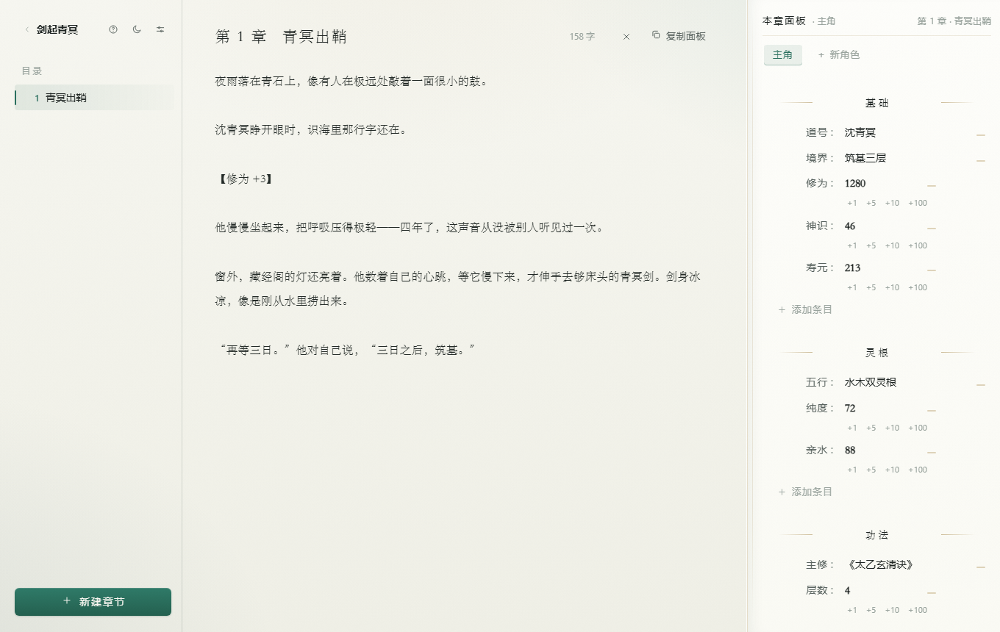
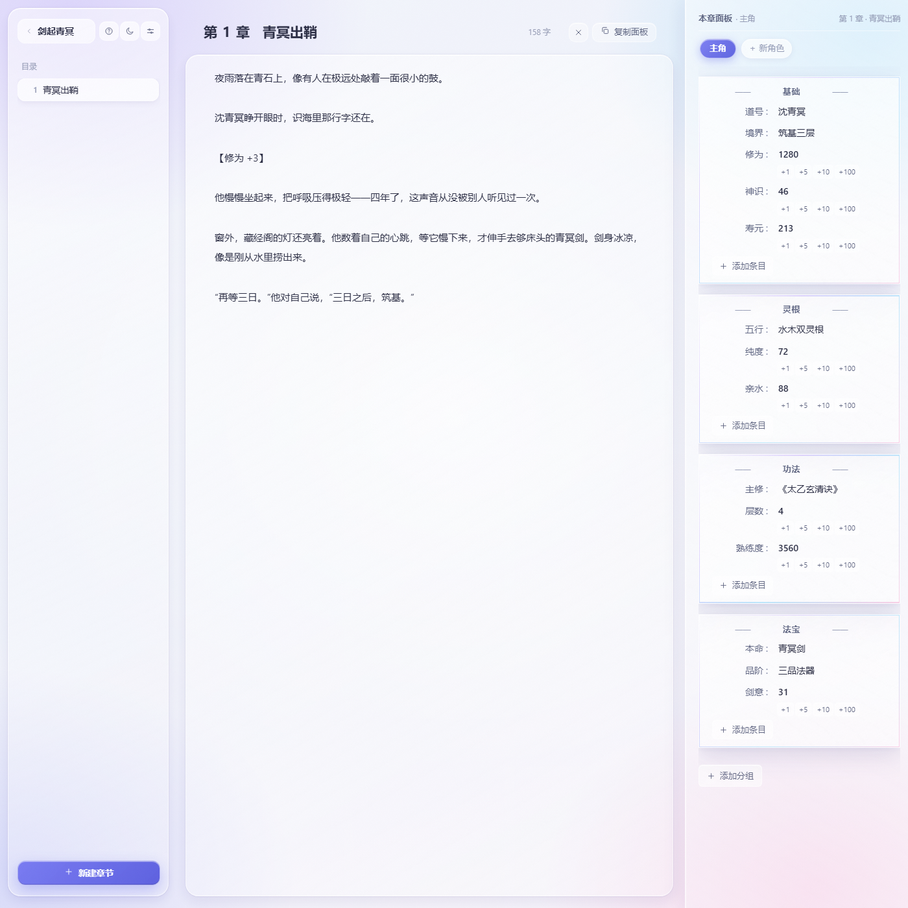

# 金手指 · 系统文创作工作台

一个给网文作者用的**系统面板管理器**。你在正文里写「系统提示」，它帮你把「本章面板」这份数据逐章维护下去：每章一份快照，下一章自动继承，改前面任何一章，后面所有章节的面板都会跟着重算。

前端是纯 HTML/CSS/JS，外壳是 C++ + WebView2 的单文件小工具，不联网、不登录、数据全在本机。



## 它解决什么问题

写系统文最烦的不是写剧情，是**面板数据不统一**：主角这章力量 115，下章手滑写成 118，再下章忘了上一章加过什么，读者一翻就穿帮。

这个工具把面板当成一份**可增量维护的数据**：

- 第 1 章 = 基准面板（基础 / 灵根 / 功法 / 法宝……分组自己定）
- 之后每章只记「本章变化」：力量 +5、新增一条法宝、改个名字
- 任意一章的面板 = 基准 + 前面所有章节的变化，自动算
- 回头改第 3 章，第 4 章之后全部自动更新

## 功能

- **多作品书架**：一个窗口管多本书，卡片式切换
- **章节树**：右侧正文编辑区直接打字，左侧目录随时跳章
- **每章一份面板快照**：新章自动继承上一章，改动只记增量
- **多角色隔离**：主角 / 配角各有独立面板，互不影响（正好配合「主角能看见别人面板」的设定）
- **数值步进**：`+1 / +5 / +10 / +100` 一键加，`Shift` 点击为减；也可以直接输入 `+3`、`-2` 表示本章相对变化
- **变化徽章**：每个数值旁标出本章变化量，一眼看出这章动了什么
- **一键复制面板**：按纯文本导出当前章节面板，直接贴进正文
- **三套主题**：仙侠（宋韵墨玉）、液态玻璃、科技控制台，都支持深浅色
- **窄屏自适应**：窗口缩小后面板变抽屉，右下角按钮唤出

快捷键：`Ctrl+S` 保存 · `Ctrl+↑/↓` 切章节 · `Alt+B` 显示/隐藏面板

## 截图

| 液态玻璃 | 面板细节 |
| --- | --- |
|  | 每章一份快照，数值旁是本章变化量 |

## 目录结构

```
novel-panel/
├── frontend/            # 前端（全部 UI 逻辑，纯静态）
│   ├── index.html
│   ├── app.css          # 三套主题 + 布局
│   ├── app.js           # 界面与交互
│   └── core.js          # 面板数据模型（纯函数，可单测）
├── src/
│   ├── main.cpp         # C++ 外壳：窗口、WebView2、读写 JSON、RPC
│   ├── app.rc           # 资源（图标）
│   ├── icon.ico
│   └── webview2_uuids.h # MinGW 下 __uuidof 需要的特化声明
├── third_party/
│   ├── nlohmann/json.hpp
│   └── webview2/        # WebView2 头文件 + WebView2Loader.dll（运行时动态加载）
├── build.bat            # 一键构建
└── dist/                # 构建输出（不入库）
```

## 构建

需要 **MinGW-w64（g++ / windres）** 和 Windows 自带的 WebView2 运行时（Win11 自带，Win10 一般也已预装）。

```bat
build.bat
```

产物是 `dist\` 下三样东西，**必须放在同一层**，缺一个都起不来：

```
dist\金手指.exe
dist\WebView2Loader.dll
dist\frontend\        （整个文件夹）
```

手工构建等价于：

```bat
windres src\app.rc -O coff -o src\app.res.o
g++ -std=c++17 -O2 -municode -mwindows -Isrc -Ithird_party\webview2 -Ithird_party ^
    src\main.cpp src\app.res.o -o "dist\金手指.exe" ^
    -lole32 -loleaut32 -lshlwapi -luuid -static -static-libgcc -static-libstdc++
xcopy frontend "dist\frontend" /E /I /Y
copy third_party\webview2\WebView2Loader.dll dist\
```

> WebView2 是**运行时动态加载**的（`LoadLibrary` + `GetProcAddress`），所以仓库里不需要那个 11MB 的 `WebView2LoaderStatic.lib`，只要头文件加 191KB 的 DLL。

前端改完不用重新编译，直接替换 `dist\frontend\` 里的文件即可。

## 数据位置

```
%APPDATA%\NovelPanel\
├── settings.json        # 主题、上次打开的作品
├── books\*.json         # 每本书一个文件（含全部章节正文与面板）
└── exports\             # 导出目录
```

纯本地文件，拷走这个文件夹就是完整备份。

## 许可

个人项目，供学习交流使用。
